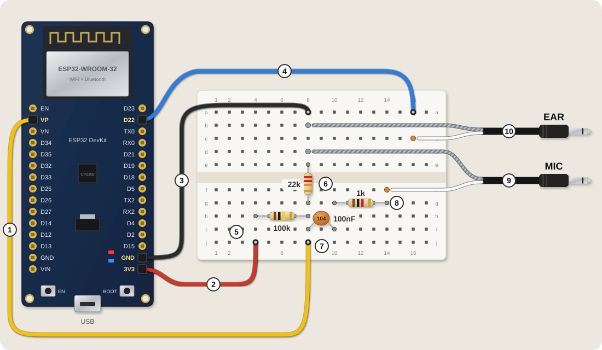
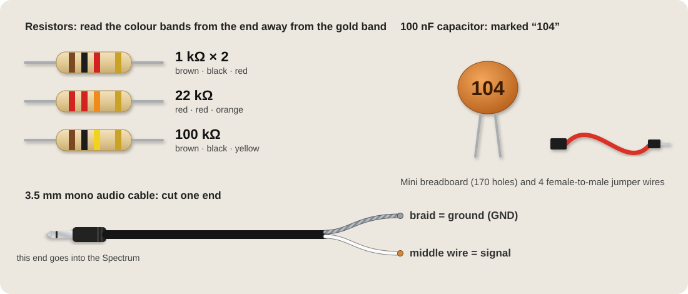
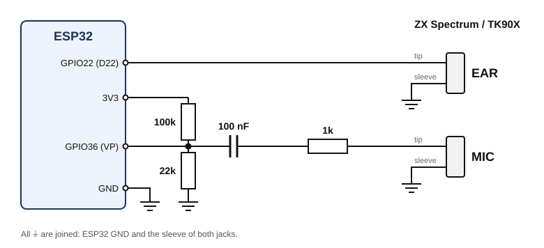

# ZX-Spec Wespi

🇧🇷 [Ler em português](https://github-com.translate.goog/miertink/zx-spec-wespi?_x_tr_sl=en&_x_tr_tl=pt&_x_tr_hl=pt-BR) ·

🇪🇸 [Leer en español](https://github-com.translate.goog/miertink/zx-spec-wespi?_x_tr_sl=en&_x_tr_tl=es&_x_tr_hl=es)

Installer in PT / ES / EN: **<https://miertink.github.io/zx-spec-wespi/>**

A WiFi tape server for the ZX Spectrum family, built on an ESP32 and a handful of
passive parts. The ESP32 plays tape files into the computer's **EAR** socket and
listens to its **MIC** socket, so the Spectrum loads from and saves to a file
server you manage from any browser. No ROM change, no edge connector: two audio
cables.

Adapted from **ZX-Wespi**, the ESP32 file server for the ZX81 by members of
ZX-TEAM (holmatic), and rewritten for the Spectrum tape format. Developed and
tested on a **TK90X** (Brazilian Spectrum 48K clone).

## Features

- **Tape formats:** `.tap`, `.tzx` (v1.20: all signal blocks, loops, jumps, calls,
  "stop the tape" with resume), `.pzx`, `.csw` (RLE and Z-RLE).
- **Menu on the Spectrum:** from power-up the ESP32 loops a small loader
  menu; type `LOAD ""`, pick a file with the cursor keys or its letter.
  The choice goes back to the ESP32 through MIC.
- **WiFi set up from the Spectrum:** the menu lists the networks in reach; pick
  one and type its password. No PC needed, not even the first time.
- **Load on request with a turbo loader** (`.tap` files): every BASIC program is
  rewritten so that each `LOAD` asks the ESP32 for its block. `LOAD ""CODE` and
  `LOAD ""SCREEN$` come in at about 3x ROM speed (2 bits per pulse, calibrated
  against ULA contention, automatic retry); other loads use the ROM with short
  pilots. Multi-part tapes continue by themselves as their programs ask for the
  next part.
- **SAVE to the server:** `SAVE` on the Spectrum stores a `.tap` on the ESP32.
- **Three languages** (Portuguese, Spanish, English) for the web page and the
  Spectrum menu: one choice for both, made with the flags on the page or in
  the menu's info screen.
- **Web page:** upload (several files at once), rename, delete, play, loop; a
  live panel for the tape (block, bytes, speed, time left) and for a SAVE in
  progress; a cassette whose reels turn while the tape plays; **Continue** for
  a tape left halfway.
- **Firmware update over WiFi:** upload `zx_iot.bin` from the web page.

## Install (no programming needed)

Open **<https://miertink.github.io/zx-spec-wespi/>** in Chrome or Edge on a
computer, connect the ESP32 by USB and click **Install** (instructions in
Portuguese, Spanish and English). Then build the interface below, type
`LOAD ""` on the Spectrum and choose your WiFi network with **W** in the menu.

Without Chrome or Edge: download `zx-spec-wespi-<version>.bin` from the
[releases](https://github.com/miertink/zx-spec-wespi/releases) and write it at
address **0x0** with Espressif's Flash Download Tool or `esptool.py write_flash
0x0 zx-spec-wespi-<version>.bin`. Installing clears the WiFi setting and the
language; the tapes on the ESP32 stay.

## Hardware

An ESP32 DevKit (ESP32-WROOM, 4 MB flash), four resistors (two 1 kΩ, one
22 kΩ, one 100 kΩ), a 100 nF capacitor and two mono 3.5 mm audio cables; for the assembly
below, a mini breadboard and 4 female-to-male jumper wires. No soldering.





On 38-pin boards follow the names printed next to the pins (VP may read SVP or
36, D22 may read IO22). The same pictures with Portuguese and Spanish captions
are on the [installer page](https://miertink.github.io/zx-spec-wespi/#hw-pt).



- **EAR:** GPIO22 drives the EAR input through 1 kΩ with 3.3 V logic (RMT
  pulses, 0.1 µs resolution). On the Spectrum the EAR socket shares its ULA pin
  with the beeper, so the game sound reaches the TV through this line too: the
  1 kΩ makes the loading tones softer on the TV, and between loads GPIO22 is
  released (high impedance) so it does not mute the game sound.
- **MIC:** the Spectrum's MIC output is weak (about 50 mV on the TK90X) and
  swings around 0 V, where the ADC does not respond. The 100 nF capacitor
  couples it to the 100k / 22k divider, which holds GPIO36 at about 0.6 V, the
  middle of the ADC range at 0 dB (0–1 V); the high-pass corner is ~85 Hz,
  well below the tape tones. The 1 kΩ on MIC protects both sides. GPIO36 is on ADC1,
  which keeps working with WiFi on.
- The ESP32 is powered from its own USB port; only the grounds are shared with
  the Spectrum. The BOOT button (GPIO0) starts / stops the menu loop; the
  status LED is on GPIO2 (GPIO21 on TTGO boards).

## Using it

1. Connect EAR and MIC and power the ESP32.
2. Turn the Spectrum on and type `LOAD ""`: the menu loads (15 to 30 s: the
   loop repeats every ~15 s and the ROM waits for its next header).
3. If the ESP32 has no network yet, press **W** in the menu and choose one (see
   below). The web address then shows under **SPACE**, and on the menu's
   second row the next time it loads.
4. Upload tapes on the web page, `http://<ip>/`.
5. Pick a file in the menu. Files marked `>` load on request (turbo); the others
   are played as they are, with short pilots where that is safe.
6. To save, use `SAVE "name"` as with a cassette recorder: the file appears on
   the web page as `name.tap`.

After a program has loaded, the tape stays silent and the EAR line is released,
so the program's sound comes through untouched. For the menu again, reset the
Spectrum, press the ESP32's **BOOT** button (or **Loop** next to `_menu.tap` on
the web page) and type `LOAD ""`.

### Menu keys

| Key | |
|-----|---|
| A–Q, ENTER | Load the file on that row / under the bar |
| 6 / 7 (cursor down / up) | Move the bar |
| 5 / 8 (cursor left / right) | Previous / next page |
| SPACE | Info (web address, network and signal, MAC, free space, version), help and language |
| W | WiFi networks |
| 0 | Back to BASIC |

Info and WiFi are not part of the menu program: the ESP32 sends them when asked,
with fresh data (a few seconds; the screen says *Loading from the ESP32...*).
This keeps the menu that loads at every start small.

### Language

The flag at the top right of the menu shows the language in use. To change it
on the Spectrum, press **SPACE**: the info screen shows the three flags; press
**1** (Portuguese), **2** (Spanish) or **3** (English), then a key, and the menu
loads again in that language. On the web page, click one of the small flags in
the footer. The choice is kept in the ESP32 and applies to both
the page and the menu. Until one is made, the page follows the browser's
language and the menu is in English. The Spectrum has no accented letters, so
its Portuguese and Spanish texts are written without them.

### Choosing the WiFi network on the Spectrum

1. Press **W**. The ESP32 scans and sends the list: the network in use on top,
   then up to 10 networks, strongest first. `+` means a password is needed;
   `****` is the signal.
2. Press the network's letter (**0** goes back).
3. Type the password at `WiFi password:` and press ENTER (only ENTER for an
   open network). It is typed with the Spectrum's own editor, so every
   character is available: `[ ] { } ~ | \` with EXTEND then SYMBOL SHIFT + key,
   as usual; a `` ` `` is typed as `£` (SYMBOL SHIFT + X), which has its code.
4. The Spectrum sends the choice through MIC; the ESP32 stores it and connects.
   The new address shows under **SPACE**.

The password is kept in the ESP32's NVS only; it never appears in the log or on
the web page. A wrong password leaves the ESP32 offline, retrying every 15 s:
choose again with **W**. Hidden networks (no name broadcast) are not listed; set
them as below.

### If something does not answer

(Messages as shown in English.)

- *Not loaded. Press a key* after SPACE or W: the request or the reply was lost
  to noise. Press a key and try again.
- *New menu: press a key, it loads*: the files changed since this menu loaded;
  the key loads the new one.
- The Spectrum keeps waiting for the tape (no border stripes): press BREAK, then
  `RUN` for the menu again, or reset the Spectrum and press BOOT.

## Building

- **ESP-IDF v4.4** (tested with 4.4.8). The code uses the legacy I2S/ADC
  drivers; v5.x is not supported yet.
- Z80 code, only to change it: [sjasmplus](https://github.com/z00m128/sjasmplus)
  1.24. The assembled binaries are in the repository.
  - `main/asm/build.cmd`: the menu and its modules. The menu goes first: the
    modules call its routines through the labels it exports (`spmenu.exp`), and
    the firmware refuses modules assembled for another menu.
  - `python tools/mkturbo.py`: the turbo loader, into `main/turbo_bin.h`.

```
idf.py build
idf.py -p COM4 flash        # first time: bootloader, partitions, app
idf.py -p COM4 app-flash    # later: the app only
```

Later updates can also go over WiFi: upload `build/zx_iot.bin` on the web page,
then reset the ESP32. A file that does not arrive whole, or is not a valid
image, is refused and the running firmware stays.

For a release: `python tools/make_release.py` (after `idf.py build`) merges
bootloader, partition table and app into `docs/firmware/zx-spec-wespi.bin`
(used by the installer page in `docs/`, published with GitHub Pages) and
`dist/zx-spec-wespi-<version>.bin` (attached to the GitHub release), and
writes `docs/manifest.json`. The version comes from `version.txt`.

`sdkconfig.defaults` holds what the project needs (4 MB flash, partition table,
web server header size); `idf.py` starts from it when `sdkconfig` is missing.

### WiFi credentials without the Spectrum

The network name and password live in NVS (namespace `zxstorage`, keys `WIFI_n`
and `WIFI_p`); the menu (**W**) writes them there. To set them from a PC
instead, keep them out of the repository: write them into a local CSV (ignored
by git), turn it into an NVS image and flash it.

`wifi.local.csv`:

```
key,type,encoding,value
zxstorage,namespace,,
WIFI_n,data,string,YourNetwork
WIFI_p,data,string,YourPassword
```

```
python %IDF_PATH%/components/nvs_flash/nvs_partition_generator/nvs_partition_gen.py generate wifi.local.csv build/wifi.nvs.bin 0x4000
python %IDF_PATH%/components/esptool_py/esptool/esptool.py -p COM4 write_flash 0x9000 build/wifi.nvs.bin
```

If NVS is empty, the firmware copies `WIFI_SSID` / `WIFI_PASSWORD` from
`idf.py menuconfig` (WiFi menu) to NVS once. They are empty by default: the
ESP32 then waits, offline, for a network chosen on the Spectrum.

### Options (`idf.py menuconfig` → ZX Spectrum tape interface)

| Option | Default | |
|--------|---------|---|
| `ZXS_TAPE_OUT_GPIO` | 22 | EAR output pin |
| `ZXS_CPU_CLOCK_HZ` | 3500000 | Z80 clock the tape timings refer to |
| `ZXS_TAPE_BLOCK_PAUSE_MS` | 1000 | Pause between blocks of a file played from the web |
| `ZXS_MENU_ON_RESET` | y | Loop the menu from power-up, not after a load |
| `ZXS_MENU_RESET_DETECT` | n | Also loop it when a Spectrum reset is seen on MIC (games can trigger it) |
| `ZXS_MENU_RESET_DELAY_MS` | 5000 | With the above: time to type `LOAD ""` before the loop starts |
| `ZXS_MENU_RELOOP` | y | (when `ZXS_MENU_ON_RESET` is off) loop the menu 3 s after each file |
| `ZXS_TURBO` | y | Load `.tap` files on request with the turbo loader |
| `ZXS_TURBO_SYM0` | 666 | Turbo: length of the shortest pulse (T-states) |
| `ZXS_SAVE_GROUP_S` | 10 | Saves this close together go into one `.tap` |
| `ZXS_LOOP_PILOT_PULSES` | 3223 | Pilot of the menu loop |
| `ZXS_LOOP_FILE` | `_menu.tap` | File the BOOT button loops |
| `ZXS_BUTTON_GPIO` | 0 | Loop button (-1: none) |

## Repository

| Path | |
|------|---|
| `main/main.c` | Start-up, status LED |
| `main/tape_out.c` | Pulse stream to EAR (RMT) |
| `main/tape_file.c` | TAP / TZX / PZX / CSW player |
| `main/tap_player.c` | Player task, loop, resume, BOOT button |
| `main/mic_in.c` | MIC sampling (I2S ADC), SAVE decoder, reset detector |
| `main/zx_menu.c`, `main/asm/spmenu.asm` | The Spectrum menu, its modules and its protocol |
| `main/asm/spinfo.asm`, `main/asm/spwifi.asm` | Menu modules: info and help, WiFi networks |
| `main/zx_turbo.c`, `main/asm/turbo.asm` | Load on request, BASIC rewrite, turbo signal |
| `main/zx_save.c` | SAVE to the server |
| `main/wifi_sta.c` | WiFi: credentials in NVS, reconnection, scan on request |
| `main/file_server.c`, `web_*.html`, `web_i18n.c`, `tape_status.c` | Web page and API; the language choice |
| `main/zx_text.c` | Texts of the Spectrum menu per language, and the flags |
| `main/weblog.c` | Log kept in RAM, served at `/log` |
| `tools/mkturbo.py` | Assembles `turbo.asm` into `turbo_bin.h` (with its relocation table) |
| `tools/make_tap.py` | Builds and checks small `.tap` test files |
| `tools/make_release.py`, `docs/` | Single-file firmware image, web installer page |
| `project.md` | Design notes and history (Portuguese) |

## Known limits

- Tested on a TK90X only; other Spectrum models should behave the same at the
  tape level, but are unverified.
- The menu expects BASIC at its usual place (`PROG` = 23755): an Interface 1 or a
  disk interface that moves it stops the menu from working.
- Some protected games assume details of the original hardware and may not run
  on a clone even when they load correctly.
- The ESP32 radio adds noise to the MIC input; the decoder tolerates it, but very
  long saves are more exposed.
- The web page has no password: anyone on the network can upload, delete or
  update the firmware. Use it on a network you trust.

## License

GPL-3.0, as the original ZX-Wespi (see `LICENSE`).
